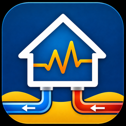

# Salon kaukolämpö Home Assistantissa

[English](README.md) | [Suomi](README.fi.md) | [Svenska](README.sv.md)

Epävirallinen MIT-lisensoitu integraatio Salon Kaukolämmön LämpöVahti-rajapintaan. Tarkoitus ei ole korvata Lämpövahtia, vaan tuoda kaukolämpödata Home Assistantiin rakennuksen energiatehokkuuden analysointia varten.

**Tila:** 0.1.0. Kenttätestattu Fedora Dockerissa Home Assistant 2026.11.0:lla. Raspberry Pi -tuotantotestaus on vielä kesken. Projekti on energiayhtiöstä riippumaton.

## API-avain

1. Avaa [asiakasportaali](https://salonkaukolampo.fi/asiakkaille/asiakasportaali/), valitse Kulutusraportit ja kirjaudu [Lämpövahtiin](https://lampovahti.salonkaukolampo.fi/login).
2. Avaa Tilini ja vieritä salasanan vaihdon alapuolella olevaan API-osioon.
3. Valitse Luo uusi avain. Kirjaa halutessasi näkyvä vanhenemispäivä. Säilytä avain salassa. Jos käyttöoikeus puuttuu, ota yhteyttä energiayhtiöön.

## Asennus

<!-- ha-marketplace:exclude-start -->
Varmuuskopioi asetukset. Avaa Home Assistant 2026.11.0:ssa tai uudemmassa Asetukset → Marketplace → Add from link ja syötä https://github.com/ollavarma-create/ha-salon-district-heating. Valitse integraatio ja asenna se. Mukautetun repositoryn asennus ja päivitykset on kenttätestattu Fedorassa.

Vaihtoehtoisesti kopioi `custom_components/salon_district_heating` asetushakemiston `custom_components`-hakemistoon ja käynnistä Home Assistant uudelleen.
<!-- ha-marketplace:exclude-end -->

Valitse Asetukset → Laitteet ja palvelut → Lisää integraatio → Salon Kaukolämpö. Syötä API-avain ja valitse käyttöpaikka. YAML-asetuksia ei tarvita.

## Sensorit ja rajoitukset

Kumulatiivinen energia (kWh), tuntienergia (kWh), tunnin keskiteho (kW), meno- ja paluulämpötila (°C), lämpötilaero (K), virtaus (m³/h), mittausaika, lukeman tila, kulutusmittauksen aika ja datan laatu.

Havaittu energiaresoluutio on 1 kWh. Tunnin keskiteho ei ole hetkellinen teho. Viivästynyt tai ristiriitainen kulutus voi säilyttää viimeisen vahvistetun arvon enintään kaksi tuntia sen mittausajasta. Tarkista datan laatu ja kulutuksen mittausaika. Ei interpolointia. Älä käytä ainoana tietolähteenä reaaliaikaisessa lämmityksen ohjauksessa tai turvatoiminnoissa.

Tiedonkeruu alkaa asennuksesta. Ei historiatietojen tuontia. Home Assistant hallitsee historiansa ja tilastonsa. Valinnainen [dashboard](examples/district-heating-dashboard.yaml) käyttää HA:n kirjaamia mittarimuutoksia, ei alkuperäisiä API-aikaleimoja. Sovita entiteettitunnisteet omaan asennukseen. Testatussa energianäkymässä ei ollut erillistä kaukolämpöluokkaa.

## API-diagnostiikka ja kustannukset

Valinnaiset avaimen vanhenemisvaroitukset (30 päivää, 7 päivää ja vanhenemispäivä), tunnistautumisen tila ja viimeisin onnistunut kysely ovat saatavilla. Määritä nykyinen ja halutessasi tuleva tariffi integraation asetuksissa arvonlisäverollisina €/kWh- ja €/kk-arvoina (syötössä desimaalipiste). Kustannukset kirjataan vain vahvistetuilta tunneilta pysyvään rekisteriin ilman kaksoiskirjauksia. Keskimääräinen kokonaishinta sisältää koko kuukauden perusmaksun, joten se voi olla poikkeuksellisen korkea kuukauden alussa tai seurannan alkaessa kesken kuukauden. Arvo tasaantuu kulutuksen kertyessä. Kattava kokonainen kuukausi antaa mielekkäimmän vertailuarvon. Arviot eivät ole laskuja. Katso [kustannuslaskenta](docs/COSTS.md).

## Dokumentaatio

[Virallinen API](https://api-lampovahti.salonkaukolampo.fi/external/api/docs/) · [API-tiedot](docs/API_DATA.md) · [Arkkitehtuuri](docs/ARCHITECTURE.md) · [Mittausrajoitukset](docs/CONSUMPTION_INTEGRITY.md) · [Jakelu](docs/DISTRIBUTION.md)

Älä julkaise API-avaimia, osoitteita, mittarin sarjanumeroita tai tunnistettavia lokeja. Ilmoita ongelmista anonymisoituina GitHubissa. [MIT-lisenssi](LICENSE).
