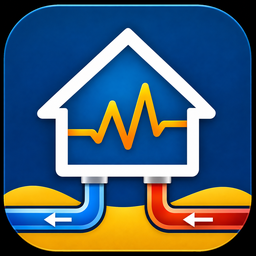

# Salon District Heating for Home Assistant

[English](README.md) | [Suomi](README.fi.md) | [Svenska](README.sv.md)

An unofficial MIT-licensed integration for the Salon Kaukolämpö LämpöVahti API. It complements rather than replaces LämpöVahti by making district heating data available for building energy efficiency analysis in Home Assistant.

**Status:** 0.1.0-alpha.4, experimental. Tested in a separate Home Assistant environment; production installation and Energy Dashboard validation are pending. Independent of the utility.

## API key

1. Sign in to [LämpöVahti](https://lampovahti.salonkaukolampo.fi/login).
2. Open Tilini (My account), then API-avaimet (API keys).
3. Select Luo uusi avain (Create new key). Keep the key private. Contact the utility if API access is missing.

## Installation for testers

Home Assistant 2026.11.0 is the initial compatibility target. Back up your configuration. Copy the repository's `custom_components/salon_district_heating` directory into your Home Assistant configuration's `custom_components` directory. Restart Home Assistant. Under Settings → Devices & services → Add integration, select Salon Kaukolämpö, enter your API key and choose a location. No YAML configuration is needed.

Community distribution metadata is prepared; installation through the community distribution UI and catalog inclusion are not yet verified.

## Sensors and limitations

Cumulative energy (kWh), hourly energy (kWh), hourly average power (kW), supply and return temperatures (°C), temperature difference (K), flow (m³/h), measurement time, reading status, consumption measurement time and data quality.

Observed energy resolution is 1 kWh. Hourly average power is not instantaneous power. Delayed or inconsistent consumption can retain the last confirmed value for up to two hours from its measurement time; check the quality and consumption timestamp. No interpolation. Do not use as the sole input for real-time heating control or safety functions.

Data collection starts at installation; no historical import, separate database or tariff engine. Home Assistant manages its own history and statistics. Energy Dashboard compatibility is being tested.

## Technical documentation

- [Official API documentation](https://api-lampovahti.salonkaukolampo.fi/external/api/docs/)
- [API fields](docs/API_DATA.md), [architecture](docs/ARCHITECTURE.md), [measurement limitations](docs/CONSUMPTION_INTEGRITY.md), [distribution](docs/DISTRIBUTION.md)

Never publish API keys, addresses, meter serial numbers or identifying logs. Report anonymized issues via GitHub. [MIT license](LICENSE).
