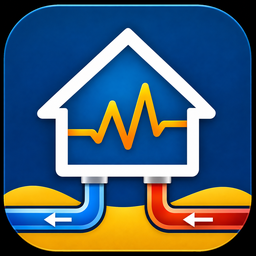

# Fjärrvärme i Salo för Home Assistant

[English](README.md) | [Suomi](README.fi.md) | [Svenska](README.sv.md)

En inofficiell integration med MIT-licens för Salon Kaukolämpös LämpöVahti-API. Integrationen kompletterar LämpöVahti genom att göra fjärrvärmedata tillgängliga i Home Assistant för analys av byggnadens energieffektivitet.

**Status:** 0.1.0-alpha.4, experimentell. Testad i en separat Home Assistant-miljö. Produktionsinstallation och energipanelen återstår att verifiera. Projektet är oberoende av energibolaget.

## API-nyckel

1. Logga in på [LämpöVahti](https://lampovahti.salonkaukolampo.fi/login).
2. Öppna Tilini (Mitt konto) → API-avaimet (API-nycklar).
3. Välj Luo uusi avain (Skapa ny nyckel). Håll nyckeln hemlig. Kontakta energibolaget om API-åtkomst saknas.

## Installation för testare

Det preliminära kompatibilitetsmålet är Home Assistant 2026.11.0. Säkerhetskopiera konfigurationen. Kopiera katalogen `custom_components/salon_district_heating` till katalogen `custom_components` i Home Assistants konfigurationskatalog. Starta om Home Assistant. Välj Inställningar → Enheter och tjänster → Lägg till integration → Salon Kaukolämpö. Ange API-nyckeln och välj förbrukningsplats. Ingen YAML-konfiguration behövs.

Metadata för gemenskapsdistribution har förberetts, men installation via distributionsgränssnittet och kataloginkludering har ännu inte verifierats.

## Sensorer och begränsningar

Ackumulerad energi (kWh), timenergi (kWh), timmedeleffekt (kW), framlednings- och returtemperatur (°C), temperaturskillnad (K), flöde (m³/h), mättid, avläsningsstatus, förbrukningens mättid och datakvalitet.

Observerad energiupplösning är 1 kWh. Timmedeleffekt är inte momentan effekt. Vid fördröjd eller inkonsekvent förbrukningsdata kan det senaste bekräftade värdet behållas i högst två timmar från dess mättid. Kontrollera datakvalitet och förbrukningens mättid. Ingen interpolering. Använd inte som enda datakälla för värmestyrning i realtid eller säkerhetsfunktioner.

Datainsamlingen börjar vid installationen. Ingen historikimport, separat databas eller tariffberäkning. Home Assistant hanterar historik och statistik. Kompatibilitet med energipanelen testas.

## Dokumentation

[Officiellt API](https://api-lampovahti.salonkaukolampo.fi/external/api/docs/) · [API-data](docs/API_DATA.md) · [Arkitektur](docs/ARCHITECTURE.md) · [Mätbegränsningar](docs/CONSUMPTION_INTEGRITY.md) · [Distribution](docs/DISTRIBUTION.md)

Publicera inte API-nycklar, adresser, mätarens serienummer eller identifierande loggar. Rapportera anonymiserade problem via GitHub. [MIT-licens](LICENSE).
